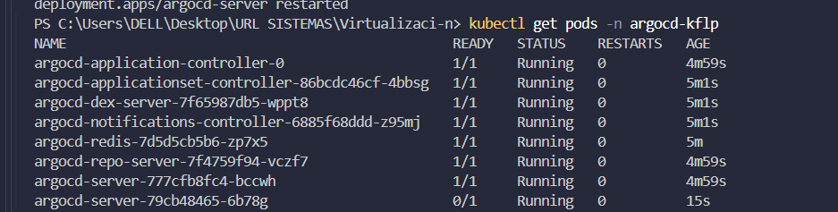
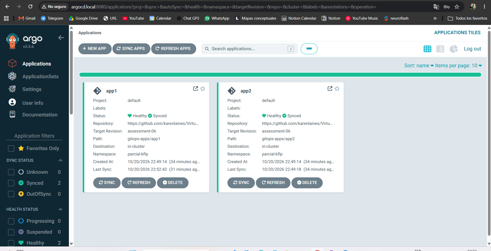
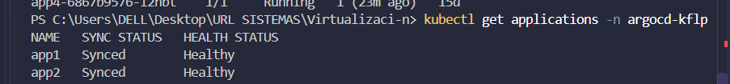
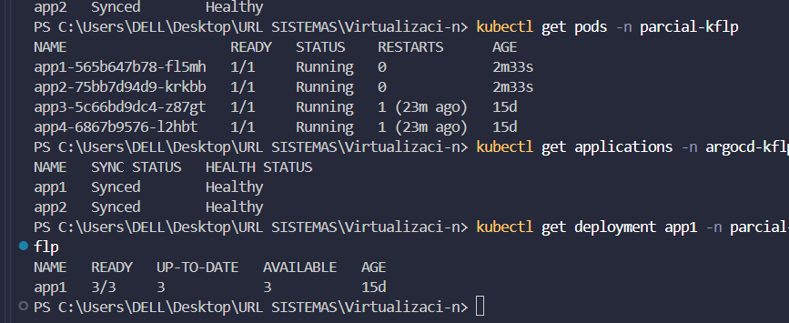
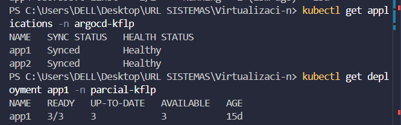

# Assessment 06 - Argo CD y GitOps

## Descripción

En esta actividad se configuró Argo CD dentro de un clúster local de Kubernetes ejecutado con Minikube.

El objetivo fue aplicar el enfoque GitOps, utilizando un repositorio de GitHub como fuente de verdad para desplegar y sincronizar aplicaciones dentro del clúster.

La arquitectura implementada es la siguiente:

```text
GitHub
  |
  v
Argo CD
  |
  v
Kubernetes
  |
  +--> Application app1
  |      |
  |      +--> Deployment app1
  |      +--> Service app1
  |
  +--> Application app2
         |
         +--> Deployment app2
         +--> Service app2
```

Además, la interfaz web de Argo CD fue expuesta mediante Traefik utilizando un nombre de dominio local.

---

## 1. Rama de trabajo

Se creó la rama:

```text
assessment-06
```

a partir de `main`.

Comandos utilizados:

```bash
git checkout main
git pull
git checkout -b assessment-06
```

---

## 2. Verificación del clúster Minikube

Se verificó que el clúster local estuviera disponible mediante:

```bash
minikube status
```

y:

```bash
kubectl get nodes
```

El nodo de Minikube se encontró en estado `Ready`.

---

## 3. Instalación de Argo CD

Argo CD fue instalado en un namespace independiente llamado:

```text
argocd-kflp
```

Se utilizó Kustomize para instalar los manifiestos oficiales de Argo CD dentro del namespace personalizado.

Archivo:

```text
argocd/kustomization.yaml
```

Configuración utilizada:

```yaml
apiVersion: kustomize.config.k8s.io/v1beta1
kind: Kustomization

namespace: argocd-kflp

resources:
  - https://raw.githubusercontent.com/argoproj/argo-cd/stable/manifests/install.yaml

patches:
  - patch: |-
      - op: replace
        path: /subjects/0/namespace
        value: argocd-kflp
    target:
      kind: ClusterRoleBinding
```

Se creó el namespace con:

```bash
kubectl create namespace argocd-kflp
```

Y Argo CD fue instalado con:

```bash
kubectl apply --server-side --force-conflicts -k argocd/
```

Posteriormente se verificaron los Pods mediante:

```bash
kubectl get pods -n argocd-kflp
```



---

## 4. Configuración de Argo CD detrás de Traefik

Para permitir que Traefik accediera al servidor de Argo CD mediante HTTP interno, se configuró:

```text
argocd/argocd-config.yaml
```

Contenido:

```yaml
apiVersion: v1
kind: ConfigMap
metadata:
  name: argocd-cmd-params-cm
  namespace: argocd-kflp
data:
  server.insecure: "true"
```

Se aplicó con:

```bash
kubectl apply -f argocd/argocd-config.yaml
```

Posteriormente se reinició el Deployment del servidor de Argo CD:

```bash
kubectl rollout restart deployment argocd-server -n argocd-kflp
```

---

## 5. Exposición de Argo CD mediante Traefik

Se creó un Ingress para exponer la interfaz web de Argo CD mediante Traefik.

Archivo:

```text
argocd/ingress.yaml
```

Configuración:

```yaml
apiVersion: networking.k8s.io/v1
kind: Ingress
metadata:
  name: argocd-ingress
  namespace: argocd-kflp

spec:
  ingressClassName: traefik

  rules:
    - host: argocd.local
      http:
        paths:
          - path: /
            pathType: Prefix
            backend:
              service:
                name: argocd-server
                port:
                  number: 80
```

El recurso fue aplicado mediante:

```bash
kubectl apply -f argocd/ingress.yaml
```

Y se verificó mediante:

```bash
kubectl get ingress -n argocd-kflp
```

---

## 6. Configuración del DNS local

En Windows se modificó el archivo:

```text
C:\Windows\System32\drivers\etc\hosts
```

agregando:

```text
127.0.0.1 argocd.local
```

Posteriormente se limpió la caché DNS:

```bash
ipconfig /flushdns
```

Debido a que Minikube se ejecuta utilizando el driver Docker en Windows, fue necesario ejecutar:

```bash
minikube tunnel
```

para permitir el acceso desde el sistema host hacia los servicios del clúster.

La interfaz de Argo CD se accedió mediante:

```text
http://argocd.local:8080
```



---

## 7. Acceso inicial a Argo CD

El usuario inicial utilizado fue:

```text
admin
```

La contraseña inicial fue obtenida desde el Secret:

```bash
kubectl -n argocd-kflp get secret argocd-initial-admin-secret -o jsonpath="{.data.password}"
```

El valor se encontraba codificado en Base64.

Se decodificó mediante PowerShell utilizando:

```powershell
$encoded = kubectl -n argocd-kflp get secret argocd-initial-admin-secret -o jsonpath="{.data.password}";
[Text.Encoding]::UTF8.GetString([Convert]::FromBase64String($encoded))
```

---

## 8. Aplicaciones administradas por Argo CD

Se utilizaron dos aplicaciones web dentro del namespace:

```text
parcial-kflp
```

Las aplicaciones fueron organizadas en el repositorio de la siguiente forma:

```text
gitops-apps/
├── app1/
│   └── app1.yaml
└── app2/
    └── app2.yaml
```

Cada archivo contiene un Deployment y un Service.

### app1

```yaml
apiVersion: apps/v1
kind: Deployment
metadata:
  name: app1
  namespace: parcial-kflp
spec:
  replicas: 1
  selector:
    matchLabels:
      app: app1
  template:
    metadata:
      labels:
        app: app1
    spec:
      containers:
        - name: nginx
          image: nginx:latest
          ports:
            - containerPort: 80

---
apiVersion: v1
kind: Service
metadata:
  name: app1-service
  namespace: parcial-kflp
spec:
  selector:
    app: app1
  ports:
    - port: 80
      targetPort: 80
```

### app2

La segunda aplicación posee una configuración equivalente utilizando los nombres:

```text
app2
app2-service
```

---

## 9. Definición de Applications de Argo CD

Las Applications de Argo CD fueron definidas como IaC en:

```text
argocd/applications.yaml
```

Cada Application apunta al repositorio de GitHub, a la rama:

```text
assessment-06
```

y a una carpeta específica del repositorio.

Ejemplo:

```yaml
apiVersion: argoproj.io/v1alpha1
kind: Application
metadata:
  name: app1
  namespace: argocd-kflp
spec:
  project: default

  source:
    repoURL: URL_DEL_REPOSITORIO
    targetRevision: assessment-06
    path: gitops-apps/app1

  destination:
    server: https://kubernetes.default.svc
    namespace: parcial-kflp

  syncPolicy:
    automated:
      prune: true
      selfHeal: true
```

Se creó una segunda Application equivalente para:

```text
app2
```

Las definiciones fueron aplicadas mediante:

```bash
kubectl apply -f argocd/applications.yaml
```

---

## 10. Verificación de sincronización

Se verificó el estado de las Applications mediante:

```bash
kubectl get applications -n argocd-kflp
```

Ambas Applications alcanzaron los estados:

```text
Synced
Healthy
```

Esto significa que:

- `Synced`: el estado del clúster coincide con lo definido en Git.
- `Healthy`: los recursos desplegados se encuentran funcionando correctamente.



---

## 11. Sincronización de un cambio mediante GitOps

Para comprobar el funcionamiento de GitOps, se realizó un cambio en el repositorio.

En la aplicación `app1` se modificó el número de réplicas:

Antes:

```yaml
replicas: 1
```

Después:

```yaml
replicas: 3
```

El cambio fue enviado al repositorio mediante:

```bash
git add .
git commit -m "feat(app1): scale deployment to three replicas"
git push
```

No se utilizó `kubectl apply` para realizar este cambio directamente sobre el clúster.

Argo CD detectó la diferencia entre el estado deseado en Git y el estado real del clúster, y realizó la sincronización automáticamente.

Se verificó mediante:

```bash
kubectl get deployment app1 -n parcial-kflp
```

mostrando las tres réplicas disponibles.



Finalmente, Argo CD volvió a mostrar la Application en estado:

```text
Synced
Healthy
```



---

## 12. Enfoque GitOps implementado

Antes de utilizar Argo CD, el despliegue se realizaba de manera manual:

```text
Usuario
  |
  v
kubectl apply
  |
  v
Kubernetes
```

Con GitOps, el flujo utilizado fue:

```text
Usuario
  |
  v
Git
  |
  v
GitHub
  |
  v
Argo CD
  |
  v
Kubernetes
```

Git se utiliza como la fuente de verdad para definir el estado deseado de las aplicaciones.

Argo CD compara continuamente el contenido del repositorio con el estado real del clúster y sincroniza los cambios cuando existe una diferencia.

---

## 13. Arquitectura final

```text
                         GitHub
                           |
                  branch assessment-06
                           |
                           v
                       Argo CD
                           |
             +-------------+-------------+
             |                           |
             v                           v
      Application app1            Application app2
             |                           |
             v                           v
      Deployment app1             Deployment app2
             |                           |
             v                           v
       app1-service                 app2-service
             |                           |
             v                           v
          Pod app1                    Pod app2

Navegador
    |
    v
argocd.local:8080
    |
    v
Traefik
    |
    v
argocd-server
```

---

## 14. Estructura de archivos

```text
.
├── argocd/
│   ├── kustomization.yaml
│   ├── argocd-config.yaml
│   ├── ingress.yaml
│   └── applications.yaml
│
├── gitops-apps/
│   ├── app1/
│   │   └── app1.yaml
│   └── app2/
│       └── app2.yaml
│
├── images/
│   ├── argocd-install.png
│   ├── argocd-browser.png
│   ├── applications-before.png
│   ├── applications-after.png
│   └── replicas-after.png
│
└── README.md
```

---

## Resultado

Se instaló Argo CD en el clúster local de Kubernetes y se configuró su acceso mediante Traefik y un dominio local.

Se conectaron dos aplicaciones al repositorio de GitHub mediante recursos `Application` de Argo CD.

Finalmente, se comprobó el enfoque GitOps modificando el estado deseado de una aplicación directamente en Git y verificando que Argo CD sincronizara automáticamente el cambio dentro del clúster.