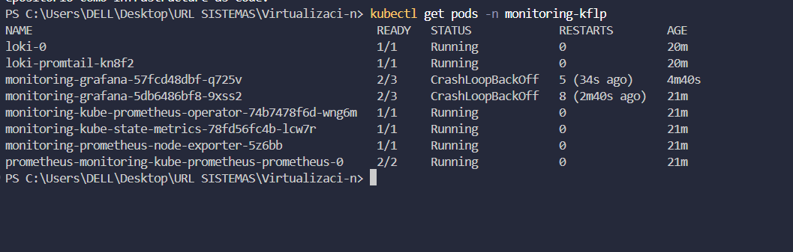
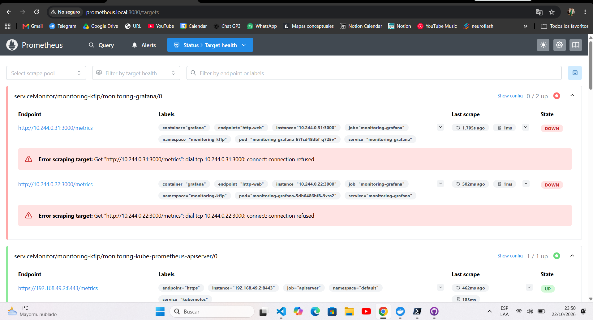
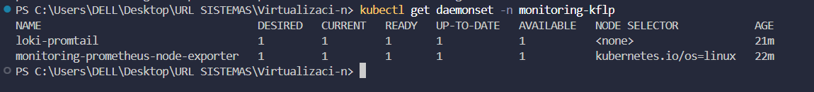
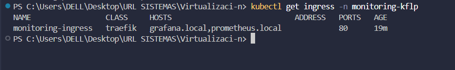
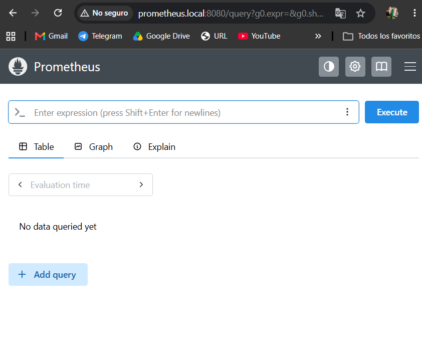

# Personal Project 01 - Monitoreo y Centralización de Logs en Kubernetes

## Descripción

En esta actividad se implementó un stack de monitoreo y centralización de logs dentro de un clúster local de Kubernetes ejecutado con Minikube.

La solución utiliza las siguientes herramientas:

- **Prometheus** para la recolección y almacenamiento de métricas del clúster.
- **Promtail** para recolectar logs de los contenedores ejecutados en Kubernetes.
- **Loki** para almacenar y consultar los logs recolectados.
- **Grafana** para visualizar las métricas obtenidas desde Prometheus y los logs almacenados en Loki.
- **Traefik** como Ingress Controller para exponer Grafana y Prometheus.
- **MetalLB** para proporcionar la IP utilizada por el servicio LoadBalancer de Traefik.

Todos los componentes de monitoreo fueron desplegados dentro del namespace:

```text
monitoring-kflp
```

La arquitectura general implementada es:

```text
                         Kubernetes
                             |
               +-------------+-------------+
               |                           |
               |                           |
             Métricas                    Logs
               |                           |
               v                           v
          Prometheus                   Promtail
                                           |
                                           v
                                         Loki
               |                           |
               +-------------+-------------+
                             |
                             v
                          Grafana
                             |
                             v
                          Traefik
                             |
                    +--------+--------+
                    |                 |
                    v                 v
             grafana.local     prometheus.local
```

---

# 1. Rama de trabajo

Para esta actividad se utilizó el mismo repositorio de las actividades anteriores.

La rama utilizada fue:

```text
personal-project-01
```

Esta fue creada a partir de `main` mediante:

```bash
git checkout main
git pull
git checkout -b personal-project-01
```

---

# 2. Verificación del clúster

Antes de iniciar la instalación del stack se verificó que Minikube estuviera funcionando correctamente:

```bash
minikube status
```

También se verificaron los Nodes del clúster:

```bash
kubectl get nodes
```

El nodo de Minikube se encontraba en estado:

```text
Ready
```

Además, se verificó que Traefik y MetalLB, configurados en actividades anteriores, continuaran funcionando.

```bash
kubectl get pods -n traefik
kubectl get svc -n traefik
kubectl get pods -n metallb-system
```

---

# 3. Namespace de monitoreo

Se creó un namespace exclusivo para todos los componentes del stack:

```text
monitoring-kflp
```

Comando utilizado:

```bash
kubectl create namespace monitoring-kflp
```

Todos los recursos correspondientes a Prometheus, Grafana, Loki y Promtail fueron desplegados dentro de este namespace.

---

# 4. Instalación mediante Helm

Para facilitar la instalación y mantener la configuración como Infrastructure as Code, se utilizó Helm.

Se agregaron los repositorios necesarios:

```bash
helm repo add prometheus-community https://prometheus-community.github.io/helm-charts
helm repo add grafana https://grafana.github.io/helm-charts
helm repo update
```

La configuración utilizada por Helm se almacenó dentro del repositorio mediante archivos `values.yaml`.

La estructura principal utilizada fue:

```text
monitoring/
├── prometheus-values.yaml
├── loki-values.yaml
├── ingress.yaml
└── dashboards/
```

---

# 5. Instalación de Prometheus

Prometheus fue instalado utilizando el chart:

```text
kube-prometheus-stack
```

Este chart también instala componentes auxiliares utilizados para obtener métricas de Kubernetes, como:

- kube-state-metrics
- node-exporter
- Prometheus Operator
- Grafana

Archivo utilizado:

```text
monitoring/prometheus-values.yaml
```

Configuración:

```yaml
grafana:
  enabled: true

  adminPassword: admin123

  additionalDataSources:
    - name: Loki
      type: loki
      access: proxy
      url: http://loki:3100
      isDefault: false

prometheus:
  prometheusSpec:
    serviceMonitorSelectorNilUsesHelmValues: false
    podMonitorSelectorNilUsesHelmValues: false

alertmanager:
  enabled: false
```

La instalación se realizó mediante:

```bash
helm upgrade --install monitoring prometheus-community/kube-prometheus-stack \
  -n monitoring-kflp \
  -f monitoring/prometheus-values.yaml
```

Posteriormente se verificaron los recursos:

```bash
kubectl get pods -n monitoring-kflp
```



---

# 6. Prometheus

Prometheus se configuró para recolectar métricas del clúster Kubernetes.

Entre las métricas disponibles se encuentran:

- uso de CPU;
- uso de memoria;
- estado de los Pods;
- información de Nodes;
- información de Deployments;
- estado general de recursos de Kubernetes.

Prometheus utiliza diferentes targets para recolectar estas métricas.

Se verificaron los targets desde la interfaz web de Prometheus.



Los targets correctamente disponibles se muestran en estado:

```text
UP
```

---

# 7. Instalación de Loki

Loki fue utilizado como sistema de almacenamiento y consulta de logs.

Se utilizó el chart `loki-stack`.

Archivo utilizado:

```text
monitoring/loki-values.yaml
```

Configuración:

```yaml
loki:
  enabled: true

promtail:
  enabled: true

  config:
    logLevel: info
    serverPort: 3101

    clients:
      - url: http://loki:3100/loki/api/v1/push

grafana:
  enabled: false

prometheus:
  enabled: false
```

La instalación se realizó mediante:

```bash
helm upgrade --install loki grafana/loki-stack \
  -n monitoring-kflp \
  -f monitoring/loki-values.yaml
```

Se verificó que Loki se encontrara ejecutándose:

```bash
kubectl get pods -n monitoring-kflp
```

---

# 8. Instalación y configuración de Promtail

Promtail fue instalado como un `DaemonSet`.

Esto permite que exista una instancia de Promtail en cada Node del clúster para recolectar los logs generados por los contenedores.

Se verificó mediante:

```bash
kubectl get daemonset -n monitoring-kflp
```



El flujo de logs implementado es:

```text
Contenedores Kubernetes
          |
          v
       Promtail
          |
          v
         Loki
          |
          v
        Grafana
```

Promtail recolecta los logs de los contenedores del clúster, incluyendo como mínimo los correspondientes a:

```text
parcial-kflp
```

donde se encuentran:

```text
app1
app2
app3
app4
```

También se recolectan los logs del namespace:

```text
traefik
```

---

# 9. Configuración de Grafana

Grafana fue instalado mediante el chart `kube-prometheus-stack`.

Su función dentro del sistema es visualizar tanto las métricas almacenadas en Prometheus como los logs almacenados en Loki.

Grafana utiliza dos fuentes de datos principales:

```text
Prometheus
Loki
```

---

# 10. Data Sources como código

Las fuentes de datos fueron configuradas mediante el archivo:

```text
monitoring/prometheus-values.yaml
```

Prometheus fue configurado automáticamente por `kube-prometheus-stack`.

Loki fue agregado mediante:

```yaml
additionalDataSources:
  - name: Loki
    type: loki
    access: proxy
    url: http://loki:3100
    isDefault: false
```

De esta forma no fue necesario crear manualmente el Data Source desde la interfaz de Grafana.

La configuración queda versionada dentro del repositorio como Infrastructure as Code.


---

# 11. Dashboards de Grafana

Se utilizaron dashboards para visualizar las métricas obtenidas por Prometheus.

Entre la información mostrada se encuentra:

- uso de CPU;
- utilización de memoria;
- estado de Pods;
- recursos del clúster.


La información visualizada en Grafana proviene de:

```text
Grafana
   |
   v
Prometheus
   |
   v
Kubernetes
```

---

# 12. Dashboard de logs

También se configuró la visualización de logs utilizando Loki como Data Source.

El flujo es:

```text
Pods
 |
 v
Promtail
 |
 v
Loki
 |
 v
Grafana
```

Los logs correspondientes al namespace de las aplicaciones pueden consultarse mediante:

```logql
{namespace="parcial-kflp"}
```

Esta consulta permite visualizar los logs de las aplicaciones:

```text
app1
app2
app3
app4
```


También pueden consultarse los logs de Traefik:

```logql
{namespace="traefik"}
```


---

# 13. Exposición mediante Traefik

Grafana y Prometheus fueron expuestos mediante Traefik.

Se utilizó el archivo:

```text
monitoring/ingress.yaml
```

Configuración:

```yaml
apiVersion: networking.k8s.io/v1
kind: Ingress
metadata:
  name: monitoring-ingress
  namespace: monitoring-kflp

spec:
  ingressClassName: traefik

  rules:
    - host: grafana.local
      http:
        paths:
          - path: /
            pathType: Prefix
            backend:
              service:
                name: monitoring-grafana
                port:
                  number: 80

    - host: prometheus.local
      http:
        paths:
          - path: /
            pathType: Prefix
            backend:
              service:
                name: monitoring-kube-prometheus-prometheus
                port:
                  number: 9090
```

La configuración fue aplicada mediante:

```bash
kubectl apply -f monitoring/ingress.yaml
```

Se verificó mediante:

```bash
kubectl get ingress -n monitoring-kflp
```



---

# 14. Configuración DNS local

Se agregaron dos nuevos nombres de dominio al archivo `hosts` de Windows.

Archivo:

```text
C:\Windows\System32\drivers\etc\hosts
```

Configuración utilizada:

```text
127.0.0.1 grafana.local
127.0.0.1 prometheus.local
```

Posteriormente se limpió la caché DNS mediante:

```bash
ipconfig /flushdns
```

Debido a que Minikube se ejecuta mediante Docker en Windows, se utilizó:

```bash
minikube tunnel
```

para permitir el acceso desde el sistema host hacia el LoadBalancer de Traefik.

---

# 15. Acceso a Prometheus

Prometheus quedó disponible mediante:

```text
http://prometheus.local:8080
```



Desde esta interfaz se pueden ejecutar consultas PromQL y revisar los targets utilizados para obtener métricas.

---

# 16. Acceso a Grafana

Grafana quedó configurado para ser accedido mediante:

```text
http://grafana.local:8080
```

Las credenciales configuradas durante la instalación fueron:

```text
Usuario: admin
Contraseña: admin123
```


---

# 17. Verificación de componentes

Para comprobar los recursos instalados se utilizaron los siguientes comandos:

```bash
kubectl get pods -n monitoring-kflp
kubectl get svc -n monitoring-kflp
kubectl get daemonset -n monitoring-kflp
kubectl get ingress -n monitoring-kflp
```

El stack instalado contiene:

```text
Prometheus
Grafana
Loki
Promtail
kube-state-metrics
node-exporter
Prometheus Operator
```

---

# 18. Arquitectura final

```text
                             MINIKUBE
                                |
                      Kubernetes Cluster
                                |
             +------------------+-------------------+
             |                                      |
             |                                      |
          Metrics                                  Logs
             |                                      |
             v                                      v
        Prometheus                              Promtail
             |                                      |
             |                                      v
             |                                     Loki
             |                                      |
             +------------------+-------------------+
                                |
                                v
                             Grafana
                                |
                                v
                             Traefik
                                |
                            MetalLB IP
                      +---------+----------+
                      |                    |
                      v                    v
                grafana.local       prometheus.local
```

---

# 19. Infrastructure as Code

La configuración del sistema fue almacenada dentro del repositorio.

Los principales archivos utilizados fueron:

```text
monitoring/
├── prometheus-values.yaml
├── loki-values.yaml
├── ingress.yaml
└── dashboards/
```

Los archivos `values.yaml` permiten reproducir la instalación realizada mediante Helm.

La configuración del Data Source de Loki también fue almacenada como código dentro de:

```text
prometheus-values.yaml
```

Los dashboards utilizados pueden almacenarse como JSON dentro de:

```text
monitoring/dashboards/
```

Ejemplo:

```text
monitoring/dashboards/
├── cluster-dashboard.json
└── logs-dashboard.json
```

De esta forma la configuración puede ser versionada, reproducida y administrada desde Git.

---

# 20. Capturas utilizadas

Las evidencias de la implementación se encuentran dentro de:

```text
images/
```

Estructura:

```text
images/
├── monitoring-pods.png
├── promtail-daemonset.png
├── monitoring-ingress.png
├── prometheus-browser.png
├── prometheus-targets.png
├── grafana-browser.png
├── grafana-datasources.png
├── grafana-metrics-dashboard.png
├── grafana-applications-logs.png
└── grafana-traefik-logs.png
```

---

# Resultado

Se implementó un sistema de observabilidad dentro del clúster local de Kubernetes utilizando Prometheus, Loki, Promtail y Grafana.

Prometheus permite recolectar métricas del clúster, mientras que Promtail recolecta los logs generados por los contenedores y los envía a Loki.

Grafana utiliza Prometheus y Loki como fuentes de datos para visualizar tanto las métricas como los logs.

Finalmente, Grafana y Prometheus fueron expuestos mediante Traefik utilizando nombres de dominio locales, manteniendo las configuraciones principales versionadas dentro del repositorio como Infrastructure as Code.